# TV home screen

Google TV-style home screen for a Bazzite living-room PC (Plasma Bigscreen, custom QML), driven by a Bluetooth remote.
Jellyfin, YouTube (VacuumTube), RiksTV (Chrome), Steam/Moonlight (Wolf), Trakt recommendations, Jellyseerr requests,
voice control (whisper.cpp) and its own settings panel. See `CLAUDE.md` for decisions, config format and rules.

## What it looks like (2026-10-29, laptop panel)

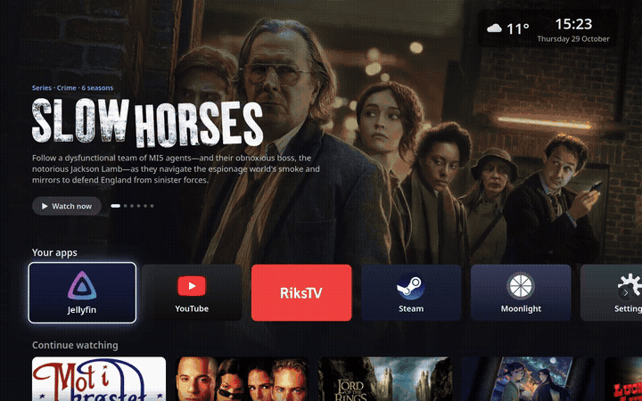

| | |
|---|---|
| 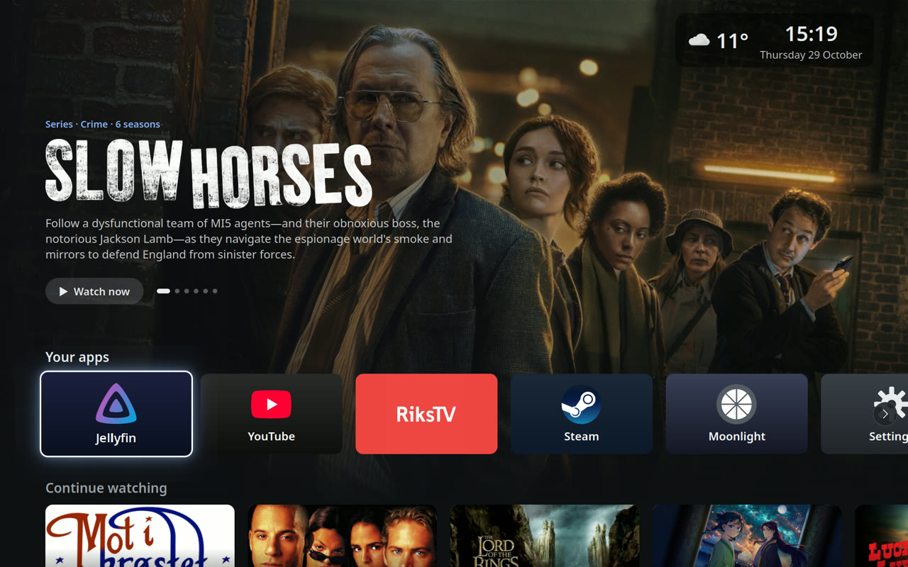 Home: Trakt banner, apps, clock and weather | 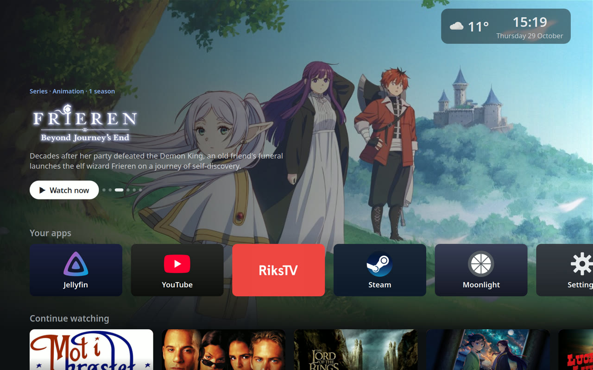 Banner rotates through Trakt picks |
| 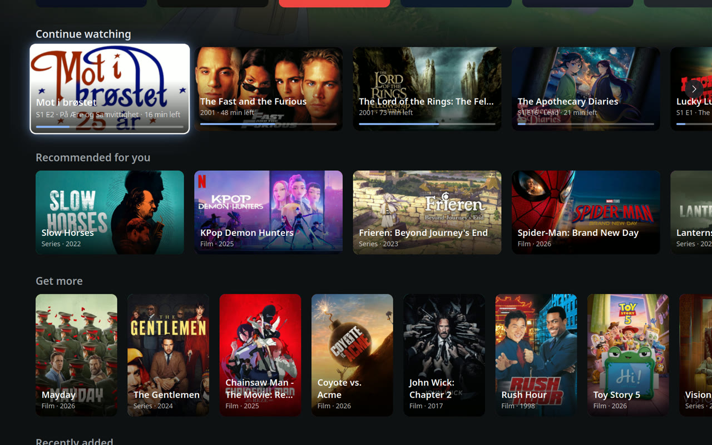 Continue watching (Jellyfin) | 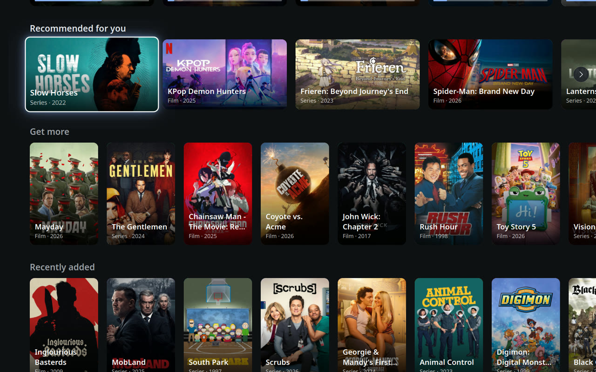 Recommended for you (Trakt, on the server) |
| 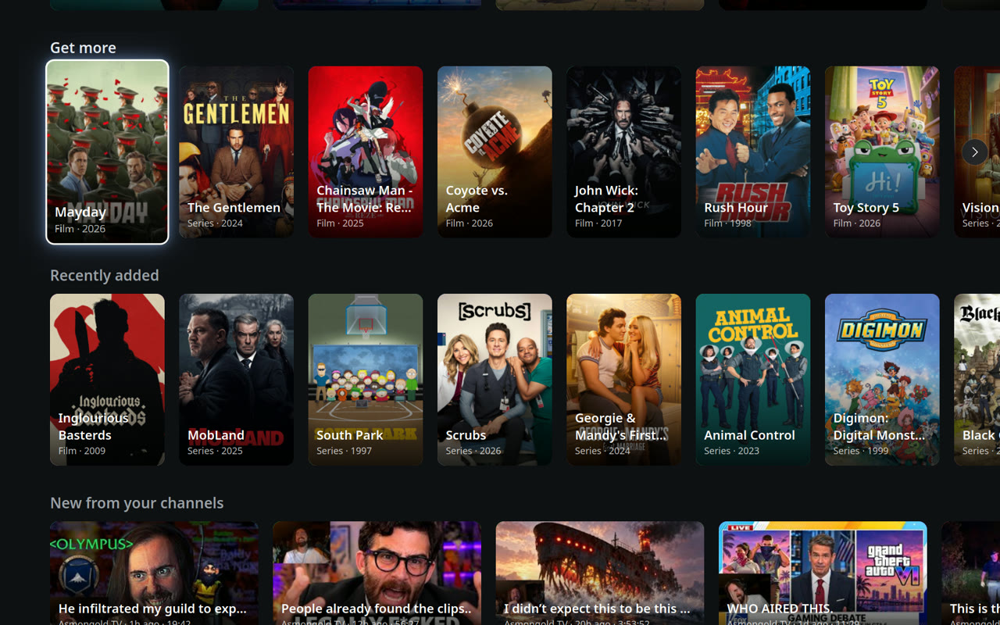 Get more: Trakt picks not on the server | 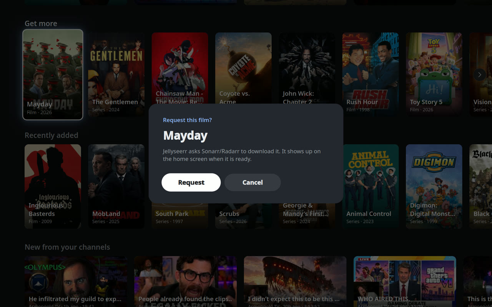 Request through Jellyseerr |
| 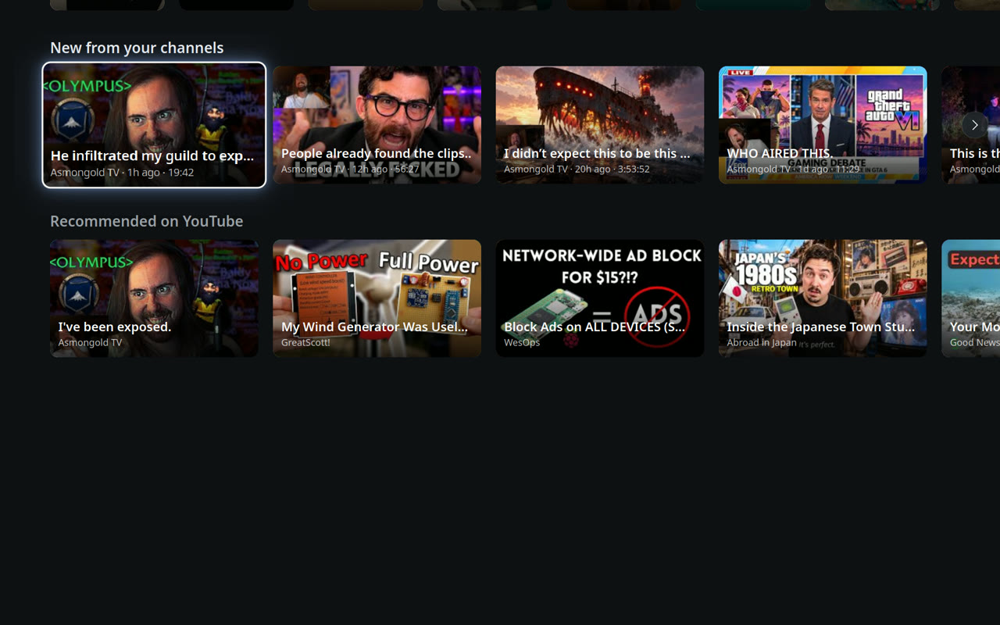 YouTube channels and recommendations | 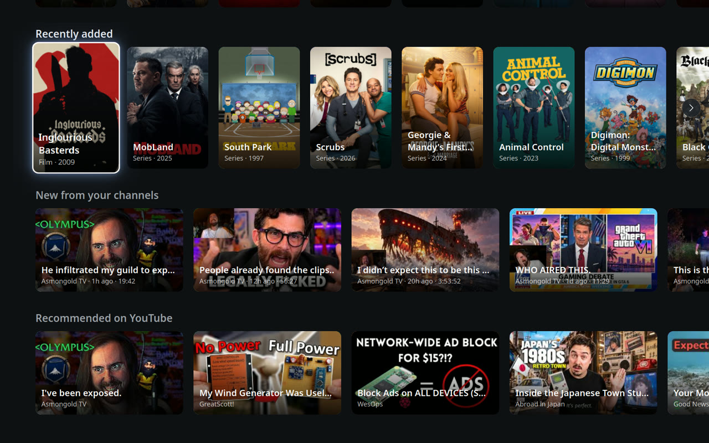 Recently added (posters) |
| 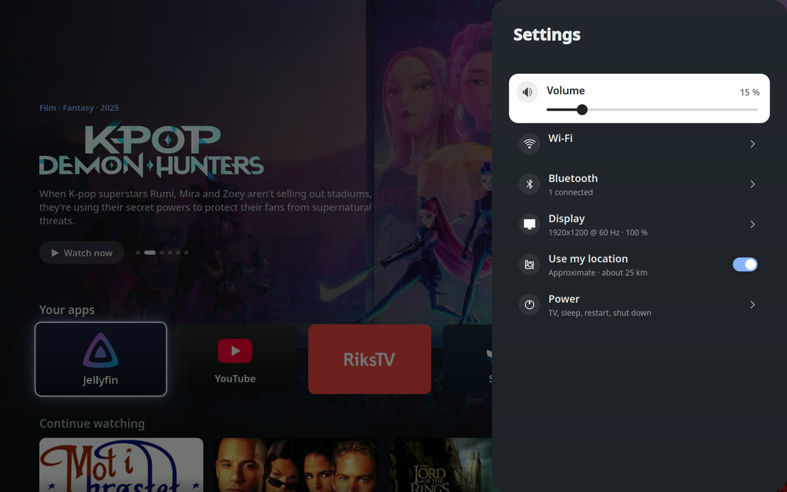 Settings slide-in | 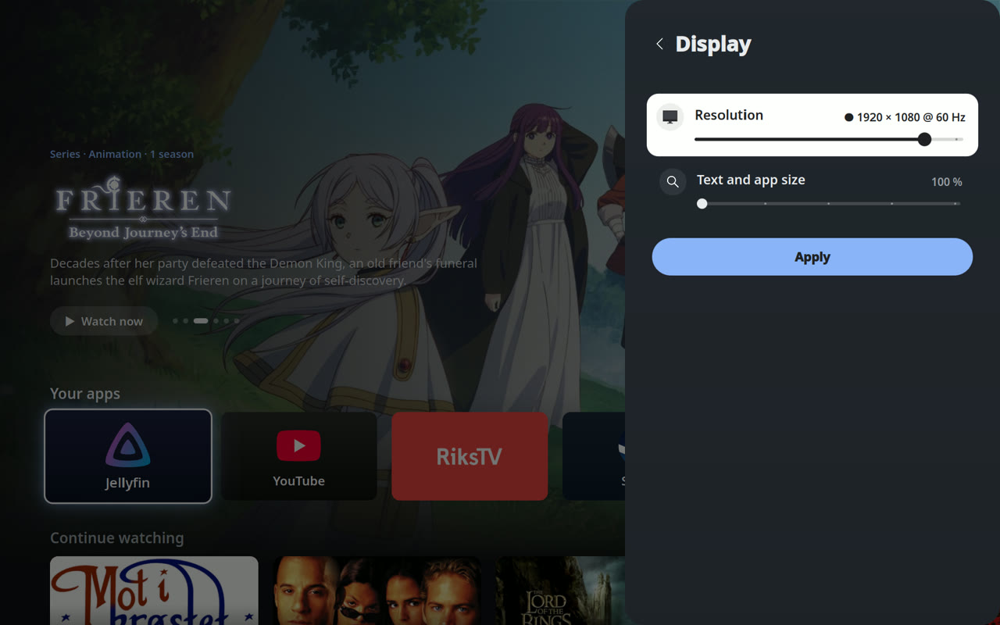 Display: sliders, Apply, auto-revert |
| 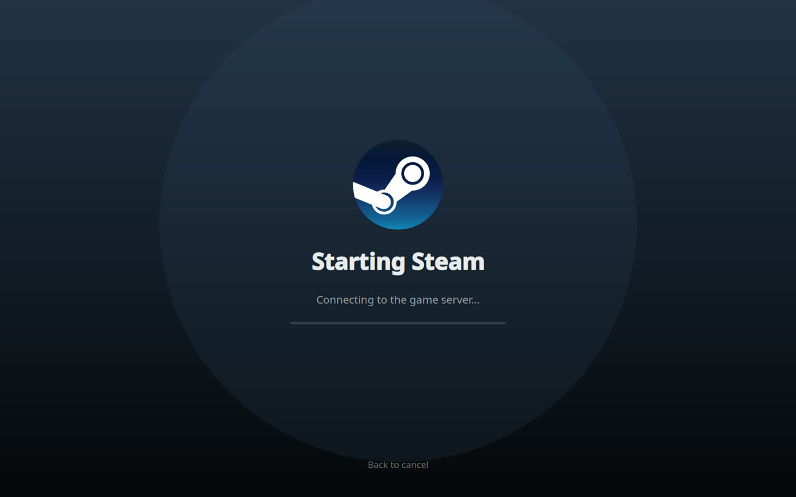 Loading screen while Steam starts (Wolf) | 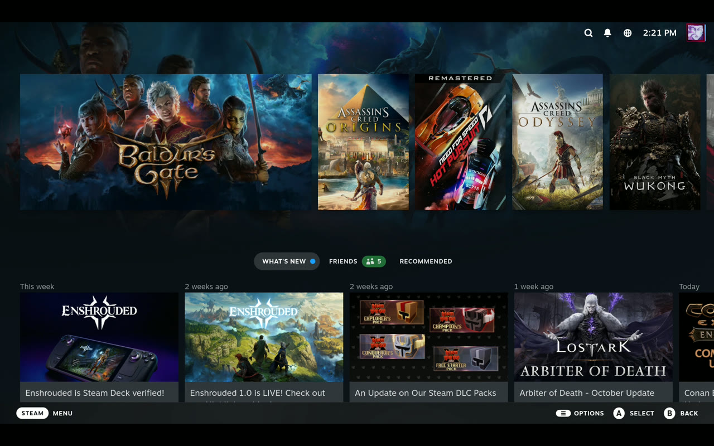 Steam Big Picture over Moonlight |

Videos (recorded as ~2.5 screenshots/s, so motion is choppy):
[browsing](docs/media/browse.mp4) · [settings](docs/media/settings.mp4) · [starting Steam](docs/media/steam.mp4)

## Run on the Bazzite laptop
```bash
cd homescreen && python3 run.py
```

## Install into Plasma Bigscreen (Bazzite laptop)
```bash
scripts/install-bigscreen.sh            # user-dir copy of the stock home screen with ours swapped in; --remove undoes it
plasma-bigscreen-swap-session           # try it in the current session (run again to swap back), or log in to Plasma Bigscreen
```

## Run headless in a container (any machine with Docker or Podman)
```bash
docker build -t tv-homescreen .
docker run --rm -it -v "$PWD":/work tv-homescreen       # podman: add :Z to the volume on SELinux hosts

# inside the container
scripts/headless-start.sh                  # Xvfb 1920x1080 + prototype in the background
scripts/key.sh Right Right Down Return     # X11 key names (Left Right Up Down Return Escape)
scripts/shot.sh shots/test.png             # screenshot of the virtual screen
cat /tmp/homescreen.log                    # QML errors and launch:/open: lines
scripts/stop.sh

# or: run it inside the real Plasma Bigscreen home screen (plasmoidviewer), then key.sh / shot.sh as above
scripts/bigscreen-start.sh
```

Watch and drive it with a real keyboard: start the container with `-p 127.0.0.1:5901:5900`, run one of the start
scripts, then `scripts/vnc.sh`, and open `vnc://localhost:5901` (password `tv`) in macOS Screen Sharing.
Rendering uses Mesa llvmpipe, so no GPU is needed. `shots/` is git-ignored.

This product uses the TMDB API but is not endorsed or certified by TMDB. Title logos from fanart.tv.
Weather data from MET Norway (api.met.no, CC BY 4.0); weather icons by Yr (MIT).
