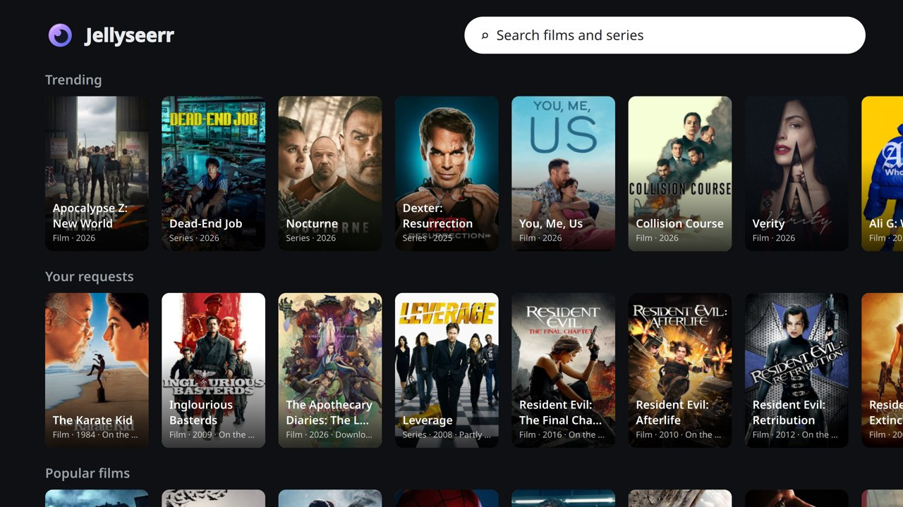
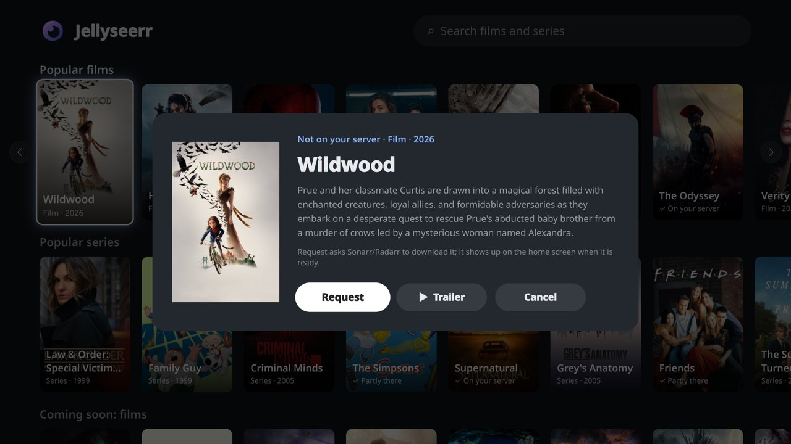
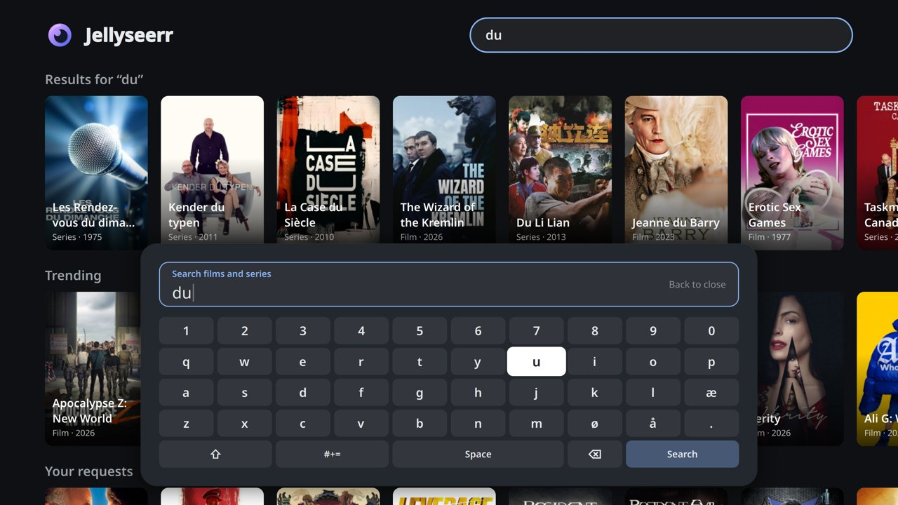
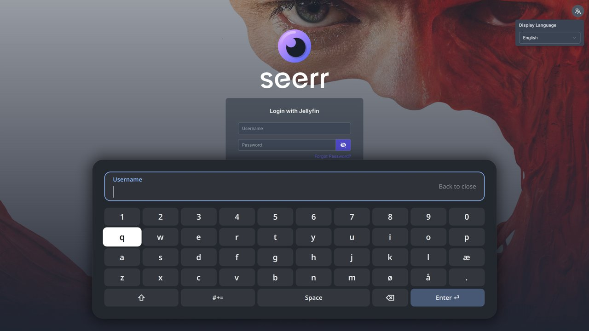
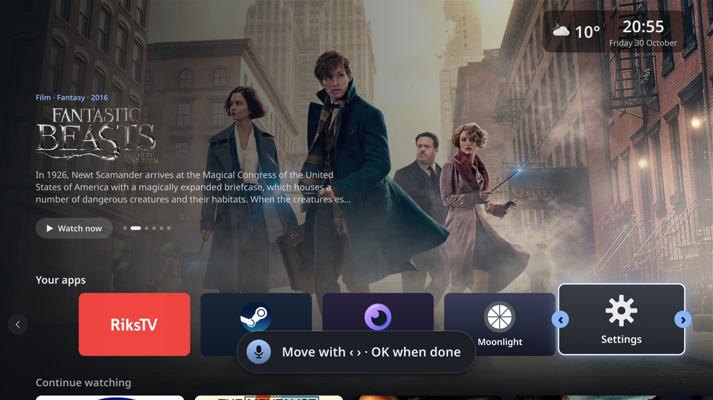

# TV home screen

A Google TV-style living room on any PC: a custom home screen for KDE Plasma Bigscreen, made for a TV remote.
Jellyfin, YouTube, game streaming and requests in one place, voice commands from the remote's own microphone, and
the TV itself switching on and off with the PC.


## What it does

- **Home screen like Google TV**: a rotating banner of recommendations, your apps, Continue watching, Recently
  added, Recommended for you, "Get more" (titles you don't have yet, with trailers), YouTube rows. Everything runs on
  the arrow keys, OK and Back.
- **Apps**: Jellyfin, YouTube (VacuumTube, the YouTube TV interface), Moonlight game streaming (Steam starts straight
  from its tile, with a loading screen), any web app in kiosk mode, Settings. Hold OK on an app to move it.
- **Jellyseerr page built for the remote**: trending and popular titles, your requests, and search with an
  on-screen keyboard. OK shows the plot, ▶ Trailer, and Request, or ▶ Play when it's already on your server.
- **Voice from the remote**: press the mic button and say "play Dune", "continue The Bear", "turn off the TV",
  "search YouTube for cats", "what's the weather". It reads the voice straight from Android TV-style Bluetooth
  remotes (Google's ATV voice protocol). Optional AI step (OpenAI): it hears through misheard names ("mobile and" →
  MobLand), works out "Harry Potter seven", asks "Did you mean…?" when unsure, and offers to download what you don't
  have. Works in English and Norwegian.
- **On-screen keyboard inside apps**: OK on a text field in Jellyfin or Jellyseerr opens a remote keyboard.
- **TV control** (LG webOS): the TV turns on (Wake-on-LAN) on the right HDMI input, and off from the remote or
  by voice. It finds the TV again if its address changes.
- **Settings for the couch**: Wi-Fi, Bluetooth pairing, display resolution and scale (with auto-revert), volume,
  power.
- **Like a real TV platform**: the screen's background follows what you select (its picture, title and plot);
  ⓘ opens details with Resume, Start over, Go to series and Mark as watched; ambient mode after 10 idle minutes;
  a "Ready to watch" card when something you requested arrives; a sleep timer on the yellow button ("turn off in 45
  minutes") and "Still watching?" after hours of untouched playback; subtitles and audio by voice ("Norwegian
  subtitles") or the subtitle button.
- **Gaming**: controllers in Settings (pairing, battery levels), a low-battery warning over games, the connected
  controllers on the loading screen, stream quality profiles (best picture, low latency...) and a badge on the Steam
  tile when a game is still running on the server.
- **Little things**: sound follows the TV over HDMI, the weather (MET Norway) in the corner, recommendations from
  Trakt that change every few hours, Back on Jellyfin's start page returns home.

| | |
|---|---|
|  Home: banner, apps, clock and weather |  Continue watching (Jellyfin) |
|  Jellyseerr page, made for the remote |  Plot, Request, Trailer |
|  Search with the on-screen keyboard |  The keyboard over an app's login |
|  Get more: recommendations not on the server |  Hold OK to move an app |
|  YouTube channels and recommendations |  Settings |
|  Loading screen while Steam starts |  Steam Big Picture over Moonlight |

Videos: [browsing](docs/media/browse.mp4) · [settings](docs/media/settings.mp4) · [starting Steam](docs/media/steam.mp4)

## What you need

- A PC connected to the TV, running **KDE Plasma 6.7 with Plasma Bigscreen**. Built and tested on
  [Bazzite](https://bazzite.gg) (Fedora Atomic), Plasma 6.7.5.
- A remote that acts as a keyboard (most Bluetooth / 2.4 GHz TV remotes and air mice). Built with a Strong
  RemoteG20 (an Android TV remote: mic and all buttons supported); others give arrows, OK and Back at least.
- Optional, each switched on by the setup:
  - a [Jellyfin](https://jellyfin.org) server (Continue watching, Recently added, playing by voice)
  - [Jellyseerr](https://github.com/Fallenbagel/jellyseerr) / Overseerr (requests)
  - a [Trakt](https://trakt.tv) account (recommendations and the banner)
  - a gaming PC with Sunshine, Apollo or Wolf (Moonlight streaming)
  - an OpenAI API key (the AI voice step; a voice command costs a fraction of a cent with gpt-5-mini)
  - an LG webOS TV (on/off control)

## Install

1. **Plasma Bigscreen** (Bazzite / Fedora Atomic; this layers a package, so reboot afterwards):
   ```bash
   rpm-ostree install plasma-bigscreen plasma-bigscreen-wayland plasma-nano
   systemctl reboot
   ```
2. **Fork or clone this repo**, then run the installer. It checks what's missing, offers to install the apps
   (Flatpaks for your user), installs the home screen into Bigscreen, and walks you through connecting your
   services:
   ```bash
   git clone https://github.com/<you>/tv ~/tv-project
   ~/tv-project/scripts/install.sh          # --check only reports, changes nothing
   ```
3. **Log out and pick "Plasma Bigscreen"** at the login screen, or try it right away with
   `plasma-bigscreen-swap-session` (run it again to go back). The installer can also set up automatic login into it.

Updating: `git pull`, then `scripts/install-bigscreen.sh` and log out and back in (or restart plasmashell).
Your settings are never in the repo, so a pull never overwrites them.

## Your settings

Run `python3 homescreen/setup.py` any time to connect or change services (`setup.py status` shows what's set up).
Everything personal lives in `~/.config/tv-project/`, never in the repo:

| File | What |
|---|---|
| `secrets.json` | server addresses and keys (Jellyfin, Jellyseerr, Trakt, OpenAI, LG TV), mode 600 |
| `apps.json`, `voice.json`, `keymap.json`, `remote.json`, `moonlight.json`, `youtube.json`, `layout.json`, `theme.json` | your changes on top of the defaults in `homescreen/config/` |
| `app-order.json` | the order you moved your apps into |

A file in `~/.config/tv-project/` only needs what you change. Objects are merged key by key, apps are matched by
`id`, and other lists replace the default list (`homescreen/tvconfig.py`). Some examples:

```jsonc
// ~/.config/tv-project/apps.json: show the hidden Steam tile, hide YouTube, add another Flatpak app
[
  {"id": "steam", "hidden": false},
  {"id": "youtube", "hidden": true},
  {"id": "kodi", "name": "Kodi", "colors": ["#17b2e7", "#0d5d7a"], "desktopId": "tv.kodi.Kodi.desktop"}
]
// ~/.config/tv-project/youtube.json: your channels for "New from your channels"
{"channels": [{"name": "Fireship", "id": "UCsBjURrPoezykLs9EqgamOA"}]}
// ~/.config/tv-project/voice.json: AI step off
{"agent": {"enabled": false}}
```

Remote buttons: `keymap.json` maps keys to actions on the home screen (arrows, OK, Back, F-keys, `evdev:<code>`
for buttons without a name), and `remote.json` sets global buttons that work inside apps too (`homescreen/remote.py
install` turns them into Plasma shortcuts). The Strong RemoteG20 profile is included (`scripts/install-remote-keys.sh`).

## How it works

- **Home screen**: plain Qt Quick (QML), dropped into Plasma Bigscreen's home-screen plasmoid
  (`bigscreen/HomeScreen.qml` replaces one file in a user copy, nothing under `/usr` changes). The same QML also runs
  in a window for development (`homescreen/run.py`).
- **Data**: small standard-library Python scripts (`homescreen/*.py`) talk to Jellyfin, Trakt, TMDb, Jellyseerr,
  YouTube and MET Norway, and write `~/.cache/tv-project/content.json`, which the home screen reads.
- **Apps** are Flatpaks started through Bigscreen. Helpers reach Jellyfin, YouTube and Jellyseerr pages over their
  DevTools ports, bound to 127.0.0.1 only. That's how Back returns home, how the keyboard types into fields, and how
  YouTube recommendations get read.
- **Voice**: `remote_mic.py` speaks Google's ATV voice protocol over Bluetooth LE (IMA ADPCM, 8 kHz) and stops when
  you stop talking. Speech-to-text runs on OpenAI or locally with whisper.cpp. Simple rules handle the common commands,
  and `agent.py` (OpenAI) handles the rest, limited to an allow-list of actions.
- **Overlays above fullscreen apps** (voice, keyboard) are layer-shell windows (`org.kde.layershell`).

`CLAUDE.md` holds the detailed notes: every component, the decisions behind them, and the problems found along the way.

## Development

```bash
cd homescreen && python3 run.py                 # the home screen in a 1920x1080 window (no apps, placeholder rows)
python3 homescreen/test_voice.py                 # tests: homescreen/test_*.py, standard library only
```

Without the TV PC, a container runs it headless (Xvfb + llvmpipe) with key and screenshot scripts:

```bash
docker build -t tv-homescreen . && docker run --rm -it -v "$PWD":/work tv-homescreen
scripts/headless-start.sh; scripts/key.sh Right Down Return; scripts/shot.sh shots/test.png; scripts/stop.sh
```
`scripts/bigscreen-start.sh` runs it inside the real Bigscreen containment instead, and `scripts/vnc.sh` shares the
screen over VNC (start the container with `-p 127.0.0.1:5901:5900`, password `tv`).

## Privacy

Keys stay in `~/.config/tv-project/secrets.json` on the PC. With the AI step on, what you say (audio and text) and
the titles on your home screen and in your library go to OpenAI. Without it, voice runs locally with whisper.cpp.
The DevTools ports are reachable only from the PC itself.

## Credits

This product uses the TMDB API but is not endorsed or certified by TMDB. Title logos from fanart.tv. Weather data
from MET Norway (api.met.no, CC BY 4.0); weather icons by Yr (MIT). App icons and names (Jellyfin, YouTube, Steam,
Moonlight, RiksTV, Jellyseerr) belong to their owners and are used only to label the apps.
